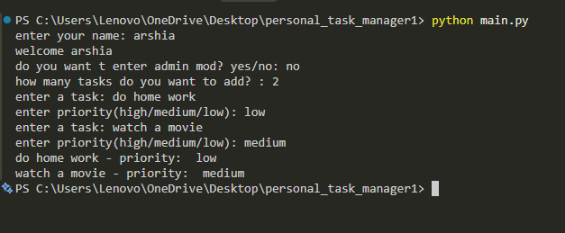
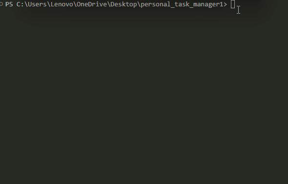

# Personal_Task_manager
A silmle Task Manager bulit with Python 


## Features
- add multiple taska
- Save tasks
- Load save Task
- Admin mod 
- set task prioriy

## Task priority 
erach task can have one of this priority levels
- low
- medium
- high

## Requirements 
- Python 
- Python-dotenv

## Project Stuctor 
```txt
personal_task_manager1/
│   .env.example
│   .gitignore
│   main.py
│   README.md
│   requirements.txt
│   tasks.py
│
├───images/
│       Animation.gif
│       scrennshot.png
```

## Installation 
Install the `requirements.txt` packahes 

``` bash 
python -m pip install -r requirements.txt
```

## Envoirment setup
create a `.env` file in the project folder 

Use `.env.example` file as a template 

Add your admin password 

``` env
admin_pass = your_password_here 
``` 

Replace `admin_pass = your_password_here ` with your own admin password 

## Run the program 
run the main file 
```bash
Python main.py
```
## Screenshot


## Demo 
